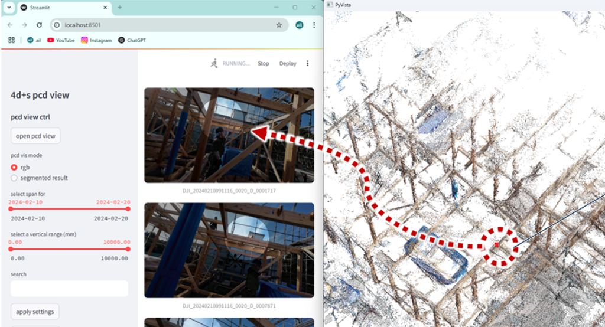
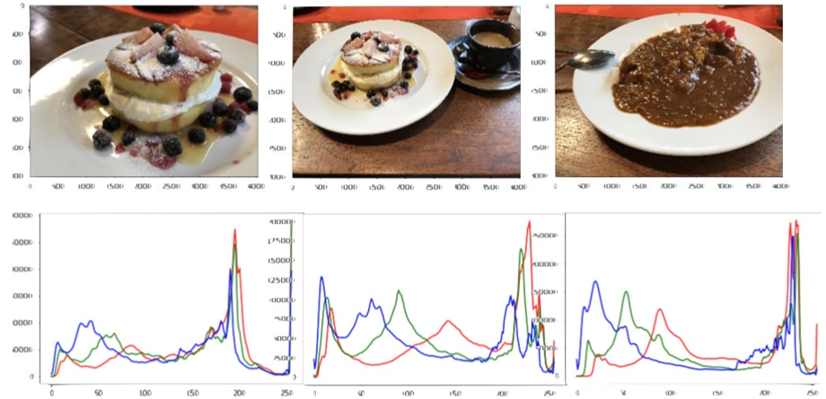
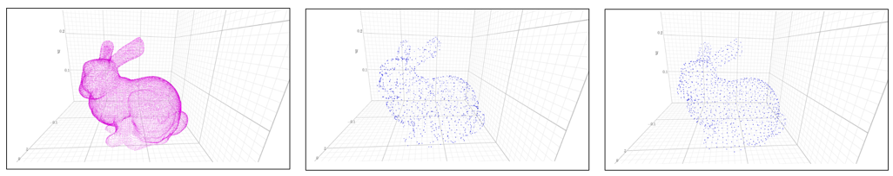
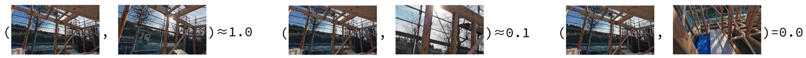
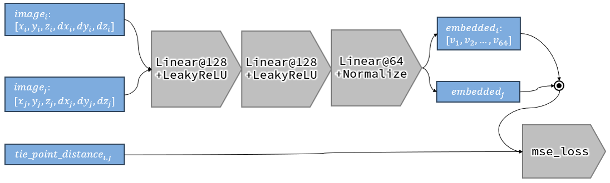
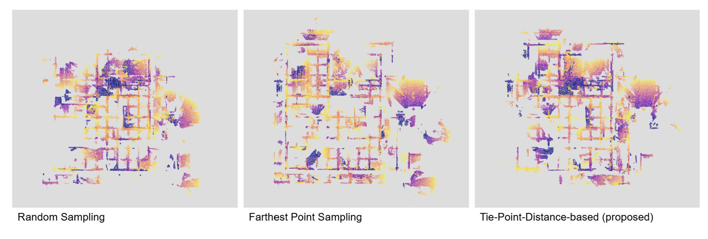
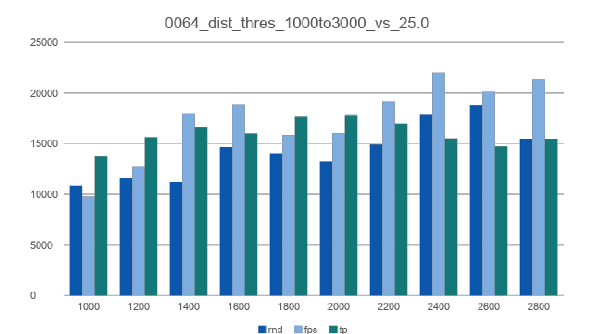

2025年12月に行われました[第48回情報・システム・利用・技術シンポジウム（情報シンポ）](https://aijisa.org/)にて、加戸研究室学生（UG4の松島くん）による報告 **「戸建て木造住宅の施工現場における作業者カメラ映像の効率的なサンプリング手法に関する研究」** が若手優秀発表賞を受賞しました。もうそろそろ次回（情報シンポ2026）の時期となってしまいましたが、この研究について紹介したいと思います。

この研究は、国土技術政策総合研究所（国総研）の方との共同研究の一環として進めているものです。
前報（[2024年の情報シンポ](https://aijisa.org/2024/)）では、戸建て木造住宅の現場作業者が装着したボディカメラ（作業者カメラ）の映像からフォトグラメトリによって出来形の三次元点群を復元し、さらにAIを活用して重要部位（ホールダウン金物など）にセマンティックを付与する情報管理手法を提案していました。

上図のように、試作したビューワでは「三次元点群上で確認したい箇所をクリックすると該当する写真がリストされる」というインデックス機能を実装しています。
ただ、日中の作業映像から三次元復元やセマンティック付与を適切に行おうとすると、タイムラプス撮影で0.5〜1秒に1枚程度の頻度で画像を切り出すことになります。すると15分程度の映像でも数千枚もの画像になり、**「似たような写真が大量にリストされて現場でのチェックがしづらい」「長期保存にあたってストレージを圧迫する」** という実用上の問題が生じてきます。

そこで本研究では、点群作成後の確認・記録用に、多数の画像から必要な情報を保ちつつ不要な画像を間引く（サンプリングする）アルゴリズムの検討を行いました。

### 既存サンプリング手法の課題

画像のサンプリング手法としてはいくつか既存のアプローチが考えられますが、建築現場の記録写真ならではの難しさがあります。

1. **RGBヒストグラムによる類似度比較**:
   古典的な手法として画像の色（RGB）のヒストグラムの相関を比較する方法がありますが、色分布に着目しているため「構図違い」に対応できません。下図のように「ケーキ」と「ケーキ＋コーヒー」よりも、色合いの構図が近い「ケーキ」と「カレー」の類似度のほうが高くなってしまうといった問題が生じます（参考：[ensekiTT Blog](https://ensekitt.hatenablog.com/entry/2018/07/09/200000)）。

   

2. **オートエンコーダ等の大域特徴量による類似度比較**:
   オートエンコーダ等で抽出した視覚的特徴量を用いてサンプリングすると、現場内の「居室Aと居室B」や「い-1とろ-1の柱梁接合部」のように、**「見た目はそっくりだが撮影場所が異なる重要な記録」のどちらか一方が破棄されてしまう** 恐れがあります。

3. **撮影位置に基づくFPS（Farthest Point Sampling）**:
   FPS（最遠点サンプリング）は、既に選択された点から最も遠い距離にある点を順次選んでいく手法です。下図のスタンフォードバニーの点群サンプリングの例のように、ランダムサンプリングと比べて全体の形状特徴を保ったまま均一にサンプリングできることが知られています（参考：[tech-deliberate-jiro.com](https://tech-deliberate-jiro.com/downsampling-fps/)）。

   

   しかし、これを画像の「撮影位置」のみに基づいて適用すると、現場全体の位置は均一にカバーできるものの、**「同じ地点から向きを変えて見回すように撮影した画像」の方向の違いを扱えず**、どちらか一方しか残らない（記録の欠けが生じる）という問題が生じます。現場の作業者カメラ映像では撮影位置が近く向きが異なるケースが多々あるため、位置だけでなく視覚的な情報量も考慮してサンプリングする必要があります。

### 提案手法：タイポイント距離とディープラーニングによる埋め込み

これらの課題を解決するため、本研究では三次元復元（SfM）の初期段階で得られる **「タイポイント（画像間の局所特徴の一致点）」** に着目しました。

2枚の画像が共有するタイポイントの数と各画像に含まれるタイポイントの総数から、ジャッカード係数に着想を得た **「タイポイント距離」** を次のように定義します。

$$dist_{tp} = 2 \times \frac{N_{ab}}{N_a + N_b}$$

ここで $N_a, N_b$ は各画像の局所特徴数、$N_{ab}$ は2画像間でマッチしたタイポイント数です。

このタイポイント距離は、下図のように直感的な類似度・包含関係を表すことができます。
- **ほぼ同じ領域を写した画像同士（左）**：タイポイントがほぼ重複し $dist_{tp} \approx 1.0$
- **一方が他方を包含する画像（中央）**：一方に情報が偏り $dist_{tp} \approx 0.1$
- **共通部分のない画像（右）**：重なりがなく $dist_{tp} = 0.0$

ただし、タイポイント距離は飽くまで画像ペア間の距離なので、これ単体では全体のサンプリングには使えません。そこで、各画像の撮影位置・向き $(x, y, z, dx, dy, dz)$ を入力とし、全結合層＋LeakyReLUを経てノルム1の埋め込みベクトルを出力するニューラルネットワークを学習させます。埋め込みベクトル同士の内積（コサイン類似度）がタイポイント距離に近づくように学習させることで、位置・向き・三次元復元への寄与度を反映したベクトル空間を構成します。

こうして得られた埋め込みベクトル空間上でFPS（最遠点サンプリング）を行うことで、三次元的な記録の欠けを最小限に抑えた画像選択が可能になります。

### 検証結果

千葉県内の木造施工現場で撮影された作業者カメラ映像（1615枚）から64枚をサンプリングし、ランダムサンプリング、撮影位置によるFPS、提案手法の3者で比較検証を行いました。

評価は「サンプリング画像から復元された点群の欠け」と「点群各点に対する最短撮影距離（近距離でしっかり撮影された点がどれだけ残っているか）」の2つの観点から行っています。

点群の欠けを比較すると、ランダムサンプリングでは全体的に大きな欠けが生じています。位置のみのFPSでは画像が密なエリアで向きの違いが処理しきれず欠けが生じるのに対し、提案手法では撮影位置の偏りの影響を受けにくく、現場全体をバランスよくカバーできていることが確認できます。

また、各点の最短撮影距離（ヒストグラム）を見ても、提案手法は近距離で撮影された点が多く含まれており、詳細な記録性を保ったまま効率的に画像数を削減できていることが示されました。

---

以上、作業者カメラ映像という実務的なデータに対する効率的なサンプリング手法の研究について紹介しました。
ネットワークのハイパーパラメータ調整や他工程への適用検証など今後の課題もありますが、現場の品質管理とデータ保存の現実的な落としどころを探る上で面白いアプローチになったのではないかと思います。

なお、今回のプログラムやコードについては現在未整理のため公開は見送りますが、いずれ整理がついたタイミングで公開できればと考えています。
