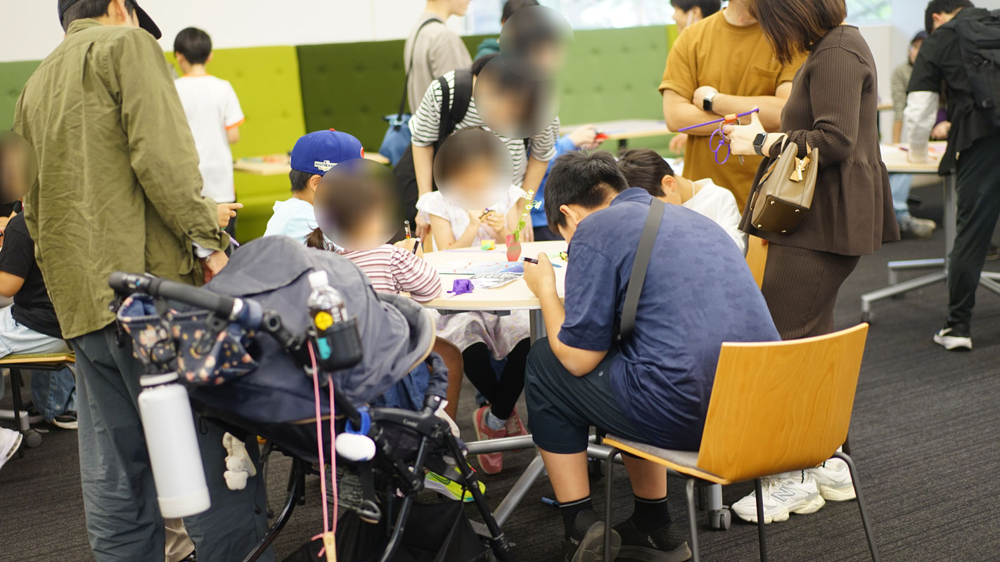
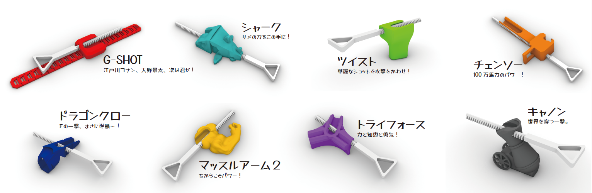
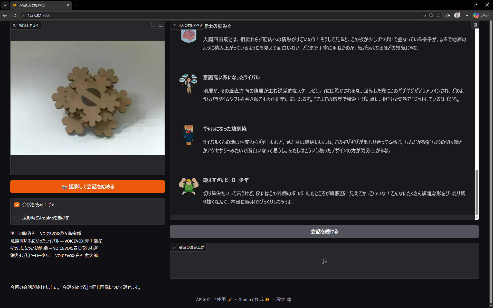
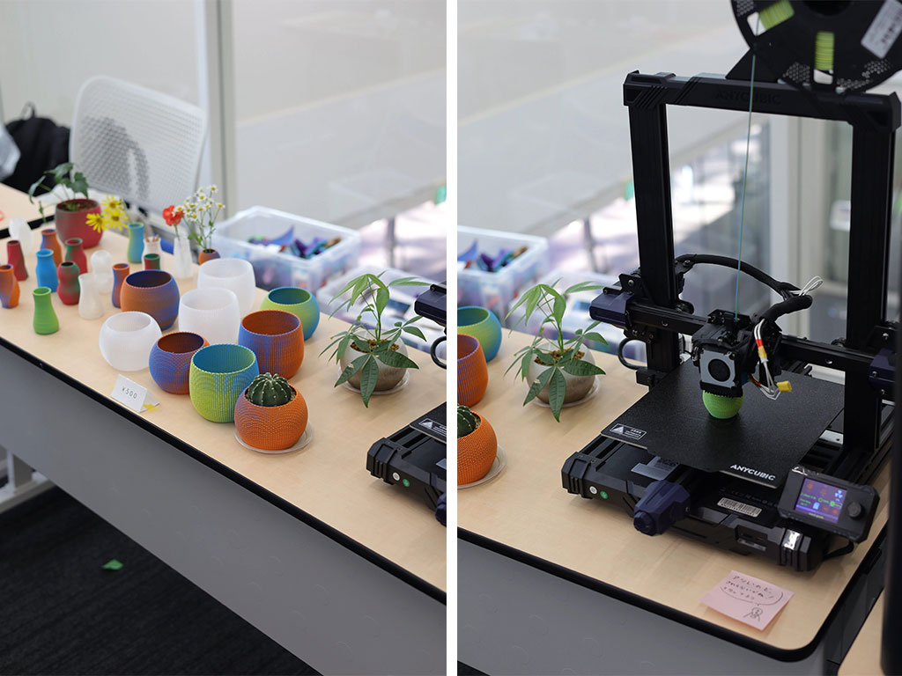
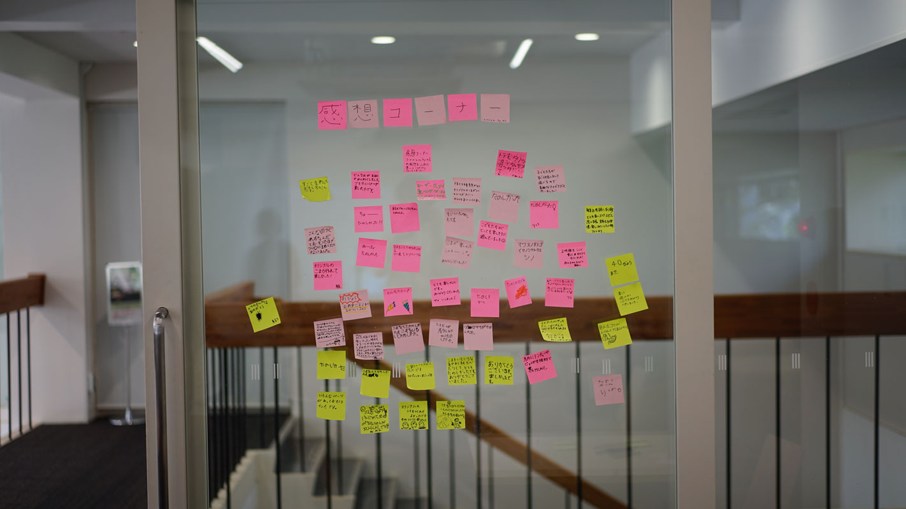

昨年に引き続き、千葉大祭に併せて開催される工学部祭において「オリジナルのコマを作ってバトルしよう」なるワークショップを開催しました！

2年目となる今回は、ありがたいことに「去年も来ました！」と、なんと**昨年バージョンの自作コマとランチャーを持参して参戦してくださった方**もいらっしゃいました。1年越しに大事に遊んでくれていた姿を見て感激しつつ…今年は準備と卒論に追われ結構使いまわしているコンテンツも多いのでコンテンツの使いまわしがバレてしまうなという焦燥化も抱きつつ…の開催となりました。今年の開催報告をまとめつつ、アップデート内容や当日の様子を活動報告・備忘録としてまとめたいと思います。

### ランチャーの更新

コマを発射するための3Dプリント製ランチャーは、今年も研究室メンバーが腕を振るって新作デザイン・改良版を開発しました。
今年度はG-SHOTやシャーク、キャノンなど可動部分のある凝ったランチャーをモデリングしてくれる学生もいて、個性豊かな計8種類のラインナップが揃いました。デザインにあたってはコンセプトやモチーフ的なものを活かしながら:
- コマが安全に発射できる
- 印刷時にサポートが入らない
- 材料費の関係で大きくなりすぎない

などの条件をクリアする必要があり、良いトレーニングになったのではないかと思っています。

### コマAIのアップデート：評価から「3人のAIによるワチャワチャ雑談」へ

今年は全体のコンテンツを大きく増やす余裕はなかったのですが、作ったコマをカメラで写して診断してくれる「コマAI」は学生がささっと改良してくれました。
昨年のコマAIは「博士・相棒・ライバル・幼馴染」の中から1人を選び、選んだキャラクターからコメントをもらう形式でした。しかし今年は、**「博士の脳みそ・鍛えすぎたヒーロー・意識高い系になったライバル・ギャルになった幼馴染の4人が、目の前のコマを見ながら勝手に雑談・議論を繰り広げる」**というマルチエージェント的な掛け合いシステムへと刷新しました。

単に点数をつけたり結論を出すのではなく、
- **鍛えすぎたヒーロー**：「～大腿四頭筋に見えてかっこいいな～」
- **博士の脳みそ**：「～相変わらず筋肉への情熱がすごいのう！～板が少しずつズレる様子が地層のよう～」
- **意識高い系になったライバル**：「～地層が生む視覚的なスケーラビリティが～」
- **ギャルになった幼馴染**：「ライバルくんの話は相変わらず難しいけど～」

といった具合に、画像認識（VLM）でコマの特徴を捉えつつ、直前のキャラの発言を拾いながらリアルタイムに会話を繋いでいきます（各キャラクターは昨年度のキャラクターの成長した姿、という苦し紛れの設定です）。

目の前でAIたちがワチャワチャと議論を始め、順番に喋ってくれる様子は今年も注目の的となっていました。建築の設計も近いうちにこんな感じで評価しつつ改良していくようになるのかもしれませんね。

### 3Dプリント小物の販売 ＆ 研究ポスター展示

今年はワークショップだけでなく3Dプリント小物の販売 ＆ 研究ポスター展示も行いました。

#### 3Dプリント製のオリジナル小物販売
デジタルファブリケーションの面白さを身近に持ち帰ってもらえるよう、研究室で製作した3Dプリント小物の物販も行いました。写真の一輪挿しはG-Codeと呼ばれる3次元プリンタ（など）の制御コードを直接Rhino+Grasshopperから生成してプリントすることでラタンが編み込まれたようなデザインを実現しています。

小物の制作の様子が見えるよう3次元プリンタも会場に持ち込み、リアルタイムでの制作も行ったところ、普段なかなか触れる機会のない3Dプリンターを皆さんしげしげと眺めてらっしゃいました。

#### 研究ポスターの展示
「コマバトルで遊べる楽しいブース」というだけでなく、普段私たちがどんな研究をしているのか:
- DeepSDF を⽤いた 3D Printable な幾何形状の探索 および体系化に関する研究
- サロゲートモデルを用いた伝統木造部品のScan to BIMの試行
- AIで建設現場の「学習用写真」をつくる
…など、最近研究室で行っている研究室を紹介するポスターも展示しました。子どもたちがバトルに熱中している合間に、保護者の方や高校生、一般の来場者の方が足を止め、想像以上に熱心にポスターを読み込んで質問してくださる場面もあり、研究室の活動を広く知ってもらう貴重な機会となりました。

### まとめ

2年目となったコマバトルワークショップですが、昨年の経験を活かした運営に加え、リピーターの方との再会という嬉しいサプライズもありました。ご来場いただいた皆様、そして準備から当日オペレーションまで走り回ってくれた研究室の学生たち、ちびっ子スタッフ（今年も娘とその友人、息子が手伝ってくれました）、顔を見せに来てくれたOBたち、改めましてありがとうございました。おかげさまで、コマのセットは200個強用意していたのですが、2日目のお昼には品切れとなる大盛況のうちにコマバトル2026を終えることができました。

…と、お疲れ会の後早速「コマバトル2027」に向けてランチャーの印刷がなされていましたが、盛大にスパゲッティ※になっていました。気持ちを切り替えて卒論・修論に取り組みなさいという思し召しなのかもしれません。

※: 3次元プリンタで印刷に失敗すると写真のようなモジャモジャができ、これを業界ではスパゲッティと呼びます。

---

### 関連リンク
- マッスルアーム2の筋肉部分は[PoliSwole - Gaben Edition by Shigster](https://www.thingiverse.com/thing:3088478)をお借りしています
- [VOICEVOX](https://voicevox.hiroshiba.jp/)
- 昨年の記事: [千葉大祭でコマバトルのワークショップを開催しました！（2025年）](https://ail-and-colleagues.github.io/komabattle2025.html)
